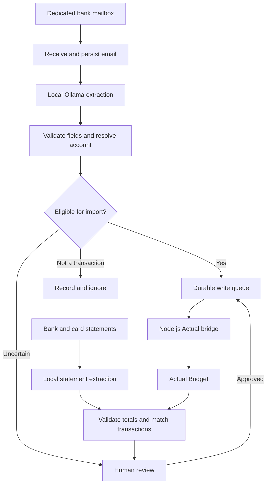

# TabbyTally 🐾

**From bank alerts to balanced books.**

TabbyTally is a self-hosted project for turning bank transaction emails into [Actual Budget](https://actualbudget.org/) entries using a local language model. Monthly statements provide a second layer of verification, helping identify missing transactions, duplicates and differences between alerts and posted activity.

The project starts with [n8n](https://n8n.io/) workflows and evolves incrementally into a Python application, keeping each working capability usable during the transition.

> **Status: early development.** The [Python IMAP receiver](imap-receiver/README.md) captures new emails into PostgreSQL and has been verified with one live inbox. Fresh-install schema migrations and backup/restore tooling are pending. Extraction, review, n8n workflows, and Actual Budget writes are not implemented. The roadmap below is an earlier proposal, not a description of shipped features. Current decisions and verification are in the [runbook](imap-receiver/runbook.md). The `imap-listener/` directory is a historical JavaScript prototype.

## Why this project exists

Bank alerts contain useful transaction information, but turning those messages into a dependable budget requires more than extracting an amount. Messages can arrive twice, refunds can appear later, card authorizations can change, and transfers can be mistaken for expenses.

TabbyTally aims to make that information useful while keeping uncertain cases visible:

- Read transaction alerts from a dedicated mailbox.
- Interpret varied email formats using a local [Ollama](https://ollama.com/) model.
- Validate the extracted facts before changing the budget.
- Track source evidence and prevent duplicate imports.
- Compare imported activity with statements when they arrive.
- Let the user review ambiguity and retain control over their records.

It is an email-and-statement integration, not a direct connection to a bank's transaction API.

## How it will work

### 1. Capture the source

A dedicated mailbox receives bank alerts. The system persists message identity and processing state before extraction, so retries and downtime can be handled without relying on whether an email is marked read.

### 2. Extract structured events

Ollama interprets the message and returns schema-constrained data: event type, account identifier, amount, currency, direction, date, merchant and bank reference where available. Missing information stays unknown instead of being guessed.

### 3. Validate and import

Application code checks critical fields, maps the account, detects duplicates and decides whether the event qualifies for import. The model does not receive budget credentials or permission to write transactions.

Accepted alert transactions are initially imported as **uncleared**. Uncertain events enter a review queue; OTPs, declined transactions and promotional messages do not become purchases.

### 4. Verify against statements

Statement processing checks account identity, period, row completeness and balance arithmetic before proposing changes. Unique matches can confirm existing entries. Missing or changed transactions and ambiguous matches receive explicit handling.

An alert absent from one statement is not automatically deleted—it may post in a later period.

## Planned capabilities

- **Local extraction:** process financial text with Ollama without requiring a cloud LLM.
- **Three operating modes:** preview, assisted imports and automatic imports for validated event types.
- **Reliable retries:** stable transaction identities and durable processing state.
- **Correct transfer handling:** link savings movements and credit-card repayments without counting them as additional spending.
- **Statement reconciliation:** account for posted transactions, fees, refunds and differences.
- **Review workspace:** inspect evidence, correct fields, approve changes and resolve matches.
- **Traceability:** connect each automated change to its source and processing history.
- **Respect for manual edits:** detect conflicts and preserve user-controlled budget fields.
- **Recoverable operation:** mailbox catch-up, backups, monitoring and controlled replay.

## Initial bank coverage

These are **implementation targets**, not claims of current support. Each account and message format must pass sample-based validation before automatic imports are enabled.

| Bank | Account type | Planned introduction |
|---|---|---|
| HDFC | Savings and associated debit-card/UPI activity | Sprints 1–3 |
| HDFC | Credit card | Sprint 4 |
| Axis | Savings and associated debit-card/UPI activity | Sprint 6 |
| SBI | Savings and associated debit-card/UPI activity | Sprint 7 |
| ICICI | Credit card | Sprint 8 |
| YES BANK | Credit card | Sprint 8 |

The initial scope is one user, one Actual budget and INR accounting. Foreign-currency authorizations, installment conversions and unfamiliar transaction lifecycles remain review-only until explicitly supported.

## Technology and responsibilities

| Component | Responsibility |
|---|---|
| n8n | Initial intake, extraction orchestration and review workflows |
| Ollama | Local email interpretation into structured events |
| PostgreSQL | Messages, events, jobs, identities and reconciliation history |
| Python | Gradually owns validation, reconciliation, review and ingestion |
| Node.js bridge | Accesses Actual through the official `@actual-app/api` client |
| Actual Budget | Budgeting interface and financial transaction records |

Durable state lives outside n8n execution history. Versioned contracts and stable event identifiers allow individual components to move into Python without recreating financial transactions.

The Node.js bridge remains part of the intended architecture. Python migration does not require reimplementing Actual's synchronization protocol.

## Incremental roadmap

Every sprint should deliver a usable improvement. Later scope will be refined using feedback from the working system.

| Sprint | Usable outcome |
|---|---|
| **01 — Preview** | An HDFC savings email becomes an inspectable transaction preview. |
| **02 — Assisted imports** | Reviewed HDFC savings events reach Actual with a durable audit trail. |
| **03 — Reliable automation** | Validated savings alerts import automatically, with catch-up and retry handling. |
| **04 — Credit-card tracking** | HDFC purchases, refunds and repayments are handled together. |
| **05 — Statement verification** | Python adds HDFC statement reconciliation and reviewed confirmations. |
| **06 — Axis and Python validation** | Axis savings joins while validation moves behind a Python API. |
| **07 — Complete savings coverage** | SBI joins, with account configuration and cross-bank transfer handling. |
| **08 — Complete target card coverage** | ICICI and YES credit join with local PDF statement processing. |
| **09 — Monthly close** | A review workspace supports repeatable reconciliation across all six accounts. |
| **10 — Python processing** | Python owns normalization, model calls and event processing. |
| **11 — Independent ingestion** | The financial pipeline runs without n8n; notifications may still use it. |
| **12 — Maintainable release** | Installation, upgrades, restoration and operations are documented and tested. |

The migration follows a consistent approach: test the replacement, run it without write authority alongside the existing path, compare results, switch a limited scope, and retain a rollback option. There is only one active authority for financial writes.

Sprint numbers describe the proposed sequence, not promised release dates.

## Getting started

There is no runnable application release yet. The first development milestone is a preview-only workflow for HDFC savings.

To prepare:

1. Record the versions and deployment details of your existing n8n and Actual instances.
2. Create a dedicated mailbox with IMAP access.
3. Gather representative bank alerts and a statement for local testing.
4. Redact any samples that will enter version control.
5. Check available RAM/GPU resources before selecting an Ollama model.
6. Build and evaluate the preview workflow before enabling budget writes.

Database provisioning and the Actual bridge follow before the first reliable import release. Installation instructions and deployable configuration will be added when the corresponding components exist.

## Project management

The companion delivery plan contains **12 sprint proposals and 96 tasks**, with implementation steps, acceptance checks, priorities, dependencies and rollback criteria. It includes CSV files intended for import into Vikunja.

Use the backlog as a living plan: complete a small working increment, demonstrate it, inspect the results and adjust the next sprint. Keep implementation code, workflow exports, schemas and regression fixtures in Git; use Vikunja for task status and delivery decisions.

## Reliability and data handling

- Keep account resolution and write eligibility in application code, not model instructions.
- Treat email content as untrusted data, including instructions embedded in a message.
- Use exact decimal conversion and integer paise for money.
- Preserve financial event identity across retries, reprocessing and migrations.
- Keep credentials and unredacted financial samples out of the repository.
- Restrict raw-message logging and define retention for statements and source evidence.
- Keep Ollama and the integration services on a private network.
- Verify backup restoration before relying on unattended operation.

Email alerts are not a complete bank ledger. Statement verification is part of the core design, and ambiguous cases remain visible rather than being silently accepted.

## Contributing

At this stage, useful contributions include refining the event schema, adding synthetic or carefully redacted examples, identifying reconciliation edge cases and implementing small roadmap tasks with acceptance evidence.

Please do not include account credentials, OTPs, full account/card numbers or unredacted statements in issues or commits. For a processing defect, provide a synthetic reproduction, the expected result and the relevant component versions.

## License

A license has not yet been selected. A `LICENSE` file will be added before inviting reuse under specific terms.

---

*Every transaction accounted for. Every nap uninterrupted.*
