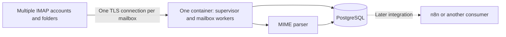
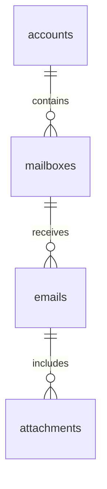

# IMAP Receiver: design

Date: 15 October 2026
Status: proposed implementation design

## Architecture

The receiver requires only IMAP and PostgreSQL connectivity. It exposes no inbound HTTP endpoint and needs no Traefik HTTP route. The first provider configuration is Purelymail over TLS on port 993; host, port, username, and mailbox remain configurable.

Use Python 3.14, standard-library imaplib (with IDLE) and email, and psycopg. Use one independent thread per mailbox for the planned synchronous worker model. Pin dependencies and commit a lockfile. The earlier prototype is reference material, not production-ready code.

The supervisor starts an independent worker for each enabled mailbox of an enabled account. Each worker owns its IMAP connection, checkpoint, reconnect loop, and health. An account authentication failure or mailbox generation change affects only its workers. A shared database outage pauses all capture safely.

Workers share a bounded PostgreSQL pool. Session advisory locks require pinned connections: reserve capacity for every active worker plus migrations and administration, and validate the configured worker limit against pool capacity. Bound aggregate parsing concurrency and memory as well as per-message size. For v1, apply configuration additions and enable/disable changes on restart; hot reload is deferred. Disabling a mailbox preserves its checkpoint, and re-enabling it catches up. A new mailbox gets a new baseline. Changing the underlying account or folder identity requires a new mailbox record or explicit reconciliation, never reuse of an unrelated checkpoint.

## Ownership boundaries

| Component | Owns |
|---|---|
| Receiver | Connection lifecycle, mailbox identity, capture, parsing, capture status |
| PostgreSQL | Durable source records, checkpoints, uniqueness, migrations |
| Future consumer | Job claims, extraction, review, categorization, Actual writes |

No webhook settings, consumer status, transaction fields, or budget credentials belong in receiver configuration or tables.

## Data model

Use a dedicated database schema, provisionally `imap_receiver`. Final SQL is an implementation deliverable.

### accounts

| Field | Meaning |
|---|---|
| id | Stable UUID primary key |
| name | User-facing account label |
| imap_host, imap_port | Server endpoint; verified TLS required |
| username | IMAP login identity |
| credential_ref | Reference to a mounted secret or environment variable, not a plaintext password |
| enabled | Whether this account's mailbox workers may run |

### mailboxes

| Field | Meaning |
|---|---|
| id | Stable UUID primary key |
| account_id | Foreign key to accounts |
| folder_path | IMAP folder path |
| enabled | Whether the supervisor starts this mailbox worker |
| uid_validity | IMAP mailbox generation, stored without JavaScript precision loss |
| last_uid | Highest UID boundary durably examined |
| initialized_at | Time the first-activation baseline was created |
| last_scan_at | Last successfully completed reconciliation |
| last_error_code | Safe diagnostic code for the most recent unresolved error |

Unique constraint: `(account_id, folder_path)`. Checkpoint fields are unset until first successful initialization. Clear last_error_code after successful recovery. Health also needs freshness checks; a stale row does not prove a worker is running.

UIDs identify messages only within the same mailbox and UIDVALIDITY generation. Do not use sequence numbers as persistent identifiers.

### emails

| Field | Meaning |
|---|---|
| id | Generated UUID primary key; stable for consumers |
| mailbox_id, uid_validity, uid | Unique source identity; mailbox_id references mailboxes |
| captured_at | Time received by this service |
| internal_date | IMAP server's message timestamp |
| message_date | Parsed Date header; nullable and not trusted as arrival time |
| message_id | Parsed Message-ID; nullable and not globally unique |
| subject | Parsed subject |
| from_addresses, to_addresses, cc_addresses | Structured JSON address lists |
| text_body, html_body | Parsed content; nullable |
| raw_email | Original RFC822 bytes, nullable only for explicit capture exceptions |
| raw_sha256 | Hash of captured source bytes |
| size_bytes | Reported or measured message size |
| capture_status | `captured`, `parse_failed`, or `oversized` |
| error_code | Bounded diagnostic code; no credentials or message bodies |
| parser_version | Parser implementation/version for reproducibility |

Unique constraint: `(mailbox_id, uid_validity, uid)`.

Message-ID and content hashes support investigation but should not suppress distinct source deliveries. Transaction deduplication belongs downstream. Separate repeated bank alerts may describe the same transaction.

### attachments

| Field | Meaning |
|---|---|
| id | UUID primary key |
| email_id | Foreign key to emails |
| part_index | Stable attachment ordinal within the captured email |
| filename, content_type | Parsed attachment metadata |
| size_bytes, content_id, sha256 | Size, inline content identity, and content hash |

Unique constraint: `(email_id, part_index)`. Original attachment bytes remain in raw_email for accepted messages. Separate attachment blob storage is deferred. Treat filenames and HTML as untrusted content; do not render HTML without sanitization downstream. Insert attachment metadata in the same capture transaction as its parent email. Default to restrictive foreign-key deletion behavior to prevent accidental evidence removal.

### Schema evolution

Use numbered migrations and a migration history table. Prefer a separate migration role; the running receiver needs table read/write permissions and its locking capability, not unrestricted database administration. Do not drop the old prototype's tables or data automatically. If prototype data exists, inspect and explicitly migrate it before adopting the new schema.

## Capture lifecycle

1. The supervisor validates configuration and loads enabled accounts/mailboxes. Each worker establishes its database ownership connection and follows the steps below independently.
2. Acquire a session advisory lock scoped to mailbox_id. Retain that connection; if it is lost, stop the affected worker before reacquiring ownership.
3. Connect to IMAP over verified TLS and open the mailbox read-only.
4. If there is no checkpoint, persist `UIDNEXT - 1` and current UIDVALIDITY as the baseline. This selection boundary defines activation; older messages are skipped.
5. Compare UIDVALIDITY on every mailbox selection. A mismatch blocks capture for operator reconciliation; never silently reset the checkpoint.
6. Subscribe to mailbox changes and reconcile immediately. Reconcile periodically as well, provisionally every 60 seconds, to cover missed notifications.
7. Scan a bounded UID range above the checkpoint. Avoid unbounded `N:*` ranges, whose reversed-range behavior can return an older message.
8. Fetch metadata first and apply the configured size limit. Fetch and parse accepted message sources using bounded memory/concurrency.
9. In a database transaction, insert each source record idempotently and advance only a safely completed UID boundary. Commit before declaring capture successful.
10. Return to IDLE. Repeat on notification, timer, or reconnect.

Scans must be serialized and requests coalesced. A notification arriving during a scan must cause another pass. For a batch, insert all fetched records and advance the batch boundary in one transaction; alternatively, advance per message only when ascending processing order is guaranteed. Do not advance past messages whose fetch failed.

UID gaps can be legitimate. After a complete successful bounded scan, advancement over absent UIDs is allowed. Messages deleted before capture cannot be recovered; the mailbox must retain mail long enough for catch-up.

## Parsing and size limits

Keep original bytes even when MIME parsing fails. Save a `parse_failed` record with an error code and allow later records to proceed. A future repair process can reparse retained evidence without retrieving IMAP again.

Proposed initial maximum: 10 MiB per source message, configurable. Fetch size before body and enforce a streaming byte limit as well. Avoid buffering large attachments through a convenience parser without a hard bound. Oversized messages produce metadata-only `oversized` records and an observable warning; they are explicitly incomplete captures, not successful full archives. Keep the original on the server for manual recovery.

## Failure handling

| Failure | Behavior |
|---|---|
| IMAP disconnect | Reconnect with capped exponential backoff and jitter, then catch up |
| Database unavailable | Stop capture advancement; reconnect/restart and reacquire ownership |
| Crash before commit | Replay from durable checkpoint; no partial successful capture |
| Commit succeeds but process loses acknowledgement | Replay is safe through unique source identity |
| Malformed MIME | Persist raw source and parse failure; continue |
| Oversized source | Persist explicit exception metadata; continue with operator visibility |
| UIDVALIDITY changes | Block intake and require reconciliation |
| Second receiver for same mailbox | Refuse ownership rather than race |
| Shutdown | Stop new scans, finish or roll back work within a bounded grace period |

Logs should contain event names, durations, counts, and safe error codes. Avoid addresses, subjects, bodies, passwords, and connection URLs by default.

## Consumer contract, deferred

Consumers read committed email records by immutable ID and keep their own processing state keyed by that ID. They should handle capture exceptions separately from normal extraction.

A later migration may add an AFTER INSERT trigger emitting only the email ID through PostgreSQL NOTIFY. This is optional and outside the receiver build. A listener must still query durable records after reconnect and periodically. Never use a maximum UUID or a timestamp alone as proof that all work was processed; use explicit consumer state and atomic claims.

## Deployment and operations

- Docker Compose for one multi-mailbox receiver container plus PostgreSQL on a private container network.
- No database host port needed for initial local verification through `docker compose exec`.
- Later cross-host consumers need a private database route, restricted roles, and appropriate TLS. An ordinary Traefik HTTP route does not provide PostgreSQL connectivity.
- Keep secrets outside Git; support file-mounted secrets or protected environment configuration.
- Back up PostgreSQL, including checkpoints and original emails; test restore.
- Do not use `docker compose down -v` for routine shutdown: it deletes the named data volume.
- Record connection health, last completed scan, capture counts, parse/size exceptions, reconnects, and checkpoint failures.
- A process can be running while capture is blocked; health reporting must distinguish these states.

## Acceptance tests

Verify first activation, new delivery, restart catch-up, already-read mail, duplicate replay, missing Message-ID, repeated Message-ID, concurrent delivery during a scan, database interruption, commit uncertainty, malformed MIME, oversized messages, UIDVALIDITY changes, competing instances, shutdown, and backup restore. Use disposable test mailboxes/databases; never reset a live mailbox to test generation changes.

Also verify simultaneous accounts, multiple folders on one account, equal UIDs in different mailboxes, one failed account while another continues, per-mailbox disable/re-enable, and adding a mailbox without resetting existing checkpoints. Verify pool sizing does not deadlock worker startup and aggregate parsing respects configured resource limits.
