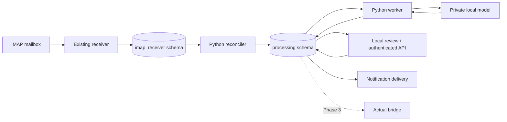

# Processing architecture

## Ownership and deployment



The processing node is a service boundary, not a requirement for a separate physical
machine. Keep the receiver independently deployable. Processing has no IMAP credentials,
capture callbacks, or Actual write credentials. There is no model call inside a database
transaction. Shared database failure still affects both services; processing isolation
does not remove that shared dependency. Limit processing connections, locks, CPU and I/O
so downstream load cannot starve capture.

Use one database with separate schemas initially to permit consistent backups and source
foreign keys. Start with one worker/model request. Reconciliation and lease recovery run
periodically even if optional ID-only notifications are introduced later. No downstream
NOTIFY or trigger is added to the receiver's capture transaction.

## Data model

All listed objects are proposed. Use UUID identities, UTC `timestamptz` audit fields,
parameterized SQL, checked state values, explicit foreign keys and restrictive deletion.

| Table in `processing` | Purpose and constraints |
|---|---|
| schema_migrations | Ordered immutable migration IDs/checksums and application time |
| pipeline_versions | Immutable code, normalizer, prompt, model configuration, schema and rule versions |
| processing_runs | Activation/replay scope, operator, enabled state and pipeline version |
| run_mailbox_boundaries | Run/mailbox/UIDVALIDITY/last UID; unique run/mailbox |
| run_email_selections | Explicit stored source IDs for sample runs; unique run/email |
| email_jobs | Source FK, pipeline version, originating run, state, due time, attempt budget, lease token/expiry; unique email/version |
| job_attempts | Unique job/attempt number; claim token, start/end, safe outcome/error, provenance and timing |
| job_results | One authoritative completion envelope per job, winning attempt and bounded outcome; fake results in 2.1, links to financial results later |
| extraction_results | Attempt-linked immutable parsed output, classification, input hash/version, protected evidence and response diagnostics |
| transaction_candidates | Stable ID, extraction/event index, facts, revision, eligibility state, validation reasons; unique extraction/event index |
| logical_accounts | User-configured bank/product/currency identities, no automatic Actual account creation |
| account_mappings | Explicit scoped masked identifiers to logical accounts; version, provenance and enabled state |
| candidate_links | Evidence-based duplicate, transfer and repayment relationships, with reviewable confidence/reasons |
| review_items | Source/job or candidate FK, reason codes, open/resolved/deferred state and revision; supports zero-candidate failures |
| review_decisions | Append-only actor/action/facts/reason/time and before/after revision history |
| callback_receipts | Unique provider/action ID, authenticated actor, request digest and committed response |
| notification_outbox | Review/revision/destination/event key, unique delivery identity, attempts, due time and delivery lease |
| operator_actions | Audited activation, retry budget changes, replay, pause and supersession actions |

Index due jobs by state/due time, leased jobs by expiry, attempts by job, source/version
lookup, open reviews and due outbox deliveries. Add financial lookup indexes only after
defining scoped identities. Do not enforce same-amount/date/merchant as a unique financial
event: legitimate repeated purchases exist.

Keep immutable extraction facts separate from corrected candidate revisions. New-version
reprocessing creates new results with explicit supersession links; it never silently
replaces approved candidates. Only the selected authoritative revision can become a
Phase 3 handoff. Duplicate model calls are allowed after crashes; duplicate authoritative
results within a job are not.

## Privileges

Use a separate migration owner; runtime roles receive no DDL, ownership or role creation.
Grant the worker SELECT only on required `emails` columns: ID, mailbox/UID identity,
capture status/error, timestamps, subject, sender metadata, text/HTML bodies, source hash
and parser version. Grant attachment metadata only if required to identify unsupported
attachment-only messages. Raw MIME, recipient lists and receiver account credentials are
not normal processing inputs. Activation additionally needs read-only mailbox checkpoint
columns. No runtime UPDATE/DELETE on the receiver schema.

Restrict worker DML to its processing responsibilities. Separate review and inspection
roles from the worker; use vetted functions where they make privilege boundaries clearer.
Any privileged function must have a fixed safe search path and explicit EXECUTE grants.
Test both allowed and denied operations, including role inheritance and PUBLIC grants.

## Activation boundary and reconciliation

The existing `captured_at` defaults to transaction time; it is not a commit cursor. UUIDs
also do not order commits. Prefer the receiver's transactional mailbox checkpoint:

1. In a consistent read, record each selected initialized mailbox's committed
   `uid_validity` and `last_uid` in the activation run, along with audit time.
2. An eligible future source row matches the mailbox and UIDVALIDITY and has a UID greater
   than that boundary. The receiver saves source rows and advances its checkpoint in one
   transaction; capture committed after activation is therefore discoverable later.
3. An in-progress capture transaction is outside the committed boundary and becomes
   eligible when committed. This defines “new” relative to captured state, not email Date.
4. Uninitialized mailboxes cannot be activated. A changed UIDVALIDITY pauses discovery for
   that mailbox/version and requires explicit receiver reconciliation and a new boundary.
5. Explicit sample source IDs may bypass the boundary under an audited sample run. Do not
   change the live boundary to run old samples or rescan historical IMAP mail.

Repeated bounded scans find eligible rows with no job and insert with conflict handling.
Each pass starts from the fixed scope or completes a full sweep before restarting; no
permanent time/UUID high-water mark may hide late commits. Bound batch size and query time.
Jobs are unique per source/version even when runs overlap. A new pipeline version requires
an explicit scope; it does not automatically replay all past data.

## Job state and fencing

```text
queued --------------------------> leased -> completed
retry_wait (when due) ------------> leased -> retry_wait
                                       |--> dead
leased (expired) -> retry_wait or dead
dead -> queued only through audited operator retry
```

`completed` means an outcome was stored, including ignored or needs-review outcomes.
`dead` means automatic processing exhausted or encountered an unrecoverable operational
failure. It is not a financial classification. Business ambiguity finishes processing
with a review item rather than consuming retries indefinitely.

Claim one job initially using a short transaction and `FOR UPDATE SKIP LOCKED`. Check the
attempt budget, set a fresh random token/expiry, increment the attempt counter, and insert
the attempt atomically. Release locks before reading/normalizing/calling the model.

To complete, lock the job and verify state, token and expiry against current database
time. In that same short transaction, save extraction/candidates/reviews/outbox intents,
finish the attempt, and mark the job completed. On failed ownership checks, roll back all
result writes. Heartbeats and retry updates use the same fence and cannot revive expired
leases. Serialize expiry recovery against completion on the job row. Evaluate expiry
using actual database wall time after acquiring the lock, not transaction-start time.

Recovery marks expired attempts as abandoned and schedules backoff or exhaustion. Only
the winning claimant can change current job results. If a client loses the commit
acknowledgement, reconnect and inspect persisted job/attempt state before taking action;
never infer failure from a missing response alone.

## Retry policy and provisional defaults

Defaults are initial configuration proposals, to be tuned in acceptance:

| Setting | Initial value |
|---|---|
| Reconciliation / recovery interval | 60 seconds / 30 seconds |
| Discovery batch / model concurrency | 100 rows / 1 request |
| Whole processing-attempt deadline / lease | 120 seconds / 180 seconds |
| Maximum claims before exhaustion | 5, including abandoned attempts |
| Backoff | Full jitter from 0 to min(15 minutes, 30 seconds × 2^(attempt−1)) |
| Model response repair | At most one repair within the same attempt deadline |

Transient network errors, overload and service timeouts retry. Invalid output gets bounded
repair, then a durable review outcome. Missing credentials or incompatible configuration
raise an operational alert and pause dispatch instead of repeatedly hammering the service.
Invalid financial facts enter review. Recovery must work while the model is unavailable.
Operator retry explicitly adds a bounded attempt allowance with an audit reason; it never
erases old attempts. Shutdown stops claiming and lets bounded active work finish, otherwise
leaves its lease for recovery.

The delivery guarantee is at-least-once execution with idempotent authoritative database
effects, not exactly-once model calls or notification sends.

## Reference

[PostgreSQL SELECT and locking](https://www.postgresql.org/docs/17/sql-select.html)
documents `SKIP LOCKED` for queue-like access. The lifecycle above is a project design
that still requires integration and crash testing.
